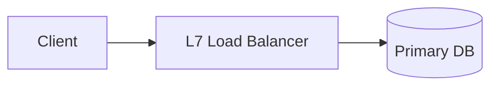

# Design doc — `<SYSTEM NAME>`

> Author · Date · Status (draft/reviewed)
> Time-boxed attempt? ☐ 40min fresh / ☐ revision pass

## 1. Problem & scope

- What are we building, for whom, in one paragraph?
- **In scope:** …
- **Out of scope** (explicitly): …

## 2. Functional requirements

Numbered FR-1..N. Each testable, each one sentence.

## 3. Non-functional requirements & estimates

| Dimension | Number | Assumption shown |
|---|---|---|
| DAU / MAU | | |
| Read QPS (avg → peak ×2.5) | | |
| Write QPS (avg → peak) | | |
| Storage / year | | |
| Latency SLO (p50/p95) | | |
| Availability target | | |

Show the arithmetic; cite the latency numbers you used.

## 4. High-level design

(replace with your real diagram)

One paragraph walking a single request through this diagram end-to-end.

## 5. Data model

Tables/collections with keys; shard key + why; what's cached and under which TTL/jitter policy.

## 6. Deep dives (pick the 2 hardest problems)

For each: options considered → choice → why → failure mode you accept.

## 7. Consistency & failure handling

- Consistency class per flow (CAP/PACELC framing from topic 04)
- What happens when each dependency dies (degraded vs down)

## 8. Bottlenecks & future work

What breaks at 10× and the planned fix. Honest weak points welcome.

---

## Self-score rubric (/25 — threshold 19)

| Criterion | Points |
|---|---|
| Estimates shown with arithmetic, peak factor applied | /4 |
| Diagram matches prose AND passes validateMermaid | /3 |
| Shard key/cache decisions justified against access patterns | /5 |
| Two deep dives consider ≥2 options before choosing | /6 |
| Failure modes named per dependency (not hand-waved) | /4 |
| Assumptions explicit where requirements were silent | /3 |
