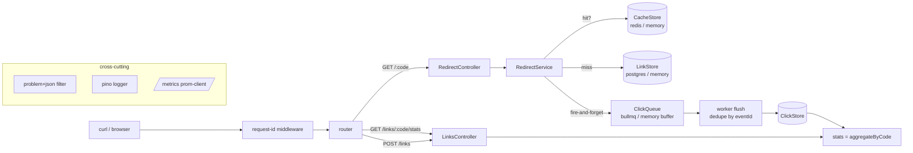

# Capstone 1 - URL Shortener (reference solution)

## What this is

The answer key for [Capstone 1](../project-brief.md): a NestJS 11 URL shortener that
demonstrates the production thinking the capstone grades for - queue-buffered click
analytics off the redirect hot path, cache-aside redirects with jittered TTLs and
negative caching, RFC 9457 error envelopes, request correlation ids, Prometheus
metrics.

It is also honest about simplifications:

- **In-memory adapters are the default wiring.** With no env vars set (and in every
  CI run) links/clicks/cache/queue are plain TypeScript classes. `pnpm test` needs
  zero external services.
- **No Prisma.** The build guide uses it for M2; this reference keeps raw SQL
  (`db/migrations/0001_init.sql` + parameterized pg adapters) so the migration file
  and the adapter code can't drift apart. The M2 intent - real migrations, committed
  SQL, minimal-column hot-path reads - is preserved.
- **k6 load reports are not included.** M5's method (baseline, one change, delta) is
  documented in the build guide; numbers only mean something on the machine that
  produced them.
- **BullMQ worker is a skeleton**: producer + worker wired and compiling, but the
  batch-accumulation window is stubbed to insert-per-job. The memory-mode worker is
  fully implemented and tested.
- **SSRF checks stop at the scheme allowlist** (http/https). Private-range IP
  blocking before persisting would be the next hardening step.
- Cache hits skip click enqueueing by design: analytics undercount repeats rather
  than put a Redis/queue write inside the redirect SLA.

## Quickstart

```bash
# Zero-dependency mode (tests AND server):
pnpm install && pnpm test          # 43 tests, no Postgres/Redis/Docker needed
pnpm start                         # boots on :3001, fully functional, in memory

# Real-adapters mode:
docker compose up -d postgres redis migrate   # wait for healthy, apply migrations
cp .env.example .env
pnpm build && pnpm start           # DATABASE_URL/REDIS_URL switch adapters on

curl -s http://localhost:3001/healthz        # {"status":"ok"}
curl -si -X POST localhost:3001/links \
  -H 'content-type: application/json' \
  -d '{"url":"https://example.com"}'         # 201 {"code":"...","url":"..."}
```

OpenAPI docs at `/docs`, Prometheus at `/metrics` in both modes.

## Milestone map

| Milestone | Key files | Proven by |
|---|---|---|
| M1 core API | `src/domain/base62.ts` (alphabet, counter+random codes, collision retry), `src/http/links.controller.ts`, `src/http/redirect.controller.ts`, `src/domain/url-validation.ts` | `src/domain/base62.spec.ts`, `src/domain/url-validation.spec.ts`, `test/redirect.e2e.spec.ts`, `test/errors.e2e.spec.ts` |
| M2 persistence & migrations | `db/migrations/0001_init.sql`, `src/infra/pg/pg-link.store.int.ts`, `src/app.ts` (adapter switch) | compiled + exercised via `*.int.ts` adapters; SQL matches adapter columns 1:1; redirect select lists only projection columns |
| M3 analytics off the hot path | `src/domain/click-worker.ts`, `src/domain/redirect.service.ts`, `src/http/links.controller.ts` (stats), `src/infra/pg/pg-click.store.int.ts` (`ON CONFLICT DO NOTHING`) | `src/domain/click-worker.spec.ts` (dedupe, batching), `test/redirect.e2e.spec.ts` (redirect -> flush -> stats), `src/domain/redirect.service.spec.ts` (queue outage cannot break redirects) |
| M4 cache layer | `src/domain/cache-keys.ts`, `src/domain/ttl.ts`, `src/domain/redirect.service.ts` (negative caching), `src/domain/links.service.ts` (invalidate-after-commit), `src/infra/redis/redis-cache.adapter.int.ts` | `src/domain/ttl.spec.ts` (jitter bounds x200), `src/domain/links.service.spec.ts` (commit-before-DEL order), `src/domain/redirect.service.spec.ts` (negative TTL 30s), `test/errors.e2e.spec.ts` (second lookup never probes store) |
| M5 load tuning | SLO encoded as histogram buckets (`src/lib/metrics.ts`) | not reproducible offline; see simplification note above |
| M6 observability | `src/lib/request-id.ts`, `src/lib/pino-logger.service.ts`, `src/lib/problem-json.ts`, `src/lib/metrics.ts`, `src/http/metrics.controller.ts` | `test/ops.e2e.spec.ts` (request-id echo, `/healthz`, `/readyz`, `/metrics` series), `src/lib/metrics.spec.ts` (hit-ratio accounting) |

## Architecture



## Decisions

| Decision | Why |
|---|---|
| Ports/adapters with in-memory defaults | CI runs anywhere; production adapters activate purely via env vars, same `buildApp()` both ways |
| Counter+random base62 codes | Deterministic sequence component (debuggable, auditable) plus random suffix so multiple instances don't collide |
| Collision probe <= 5 then throw | Random suffix makes 5 collisions astronomically unlikely; hitting the cap means something is broken, fail loudly |
| Jittered TTL (+/-10% around 300s) | De-synchronizes key expirations; prevents thundering-herd refills after traffic spikes |
| Browser max-age fixed at 300 (not jittered) | Jitter is an origin-cache defense; stable headers play nicer with proxies/CDNs |
| Negative caching, 30s TTL | Bot scans of random codes hit Redis instead of Postgres; short TTL bounds staleness if a code appears later |
| DEL after DB commit | Reversed order lets concurrent readers re-populate stale entries that survive a full TTL (order asserted by unit test) |
| Clicks fire-and-forget with `.catch(log)` | A queue outage degrades analytics, never availability - the whole point of M3 |
| Dedupe by eventId (flush + PK + ON CONFLICT) | At-least-once queues guarantee redelivery somewhere; idempotent sink absorbs it at every layer |
| Stats read pre-aggregated counts only | `COUNT(*) FILTER` over `(code, ts DESC)` index; never scans or returns raw events |
| Raw SQL instead of Prisma (deviation from guide's M2 letter) | Keeps committed migration and runtime queries provably identical; intent of M2 unchanged |

## API tour

```bash
BASE=http://localhost:3001

# Create (400 problem+json if scheme isn't http/https or url > 2048 chars)
curl -s -X POST $BASE/links -H 'content-type: application/json' \
  -d '{"url":"https://example.com/very/long/path"}'
# -> 201 {"code":"0aZ9xQm","url":"https://example.com/very/long/path"}

# Optional expiry (epoch ms)
curl -s -X POST $BASE/links -H 'content-type: application/json' \
  -d '{"url":"https://example.com/promo","expiresAt":1798761600000}'

# Redirect (302, Location + Cache-Control: public, max-age=300)
curl -si $BASE/0aZ9xQm

# Unknown code: 404 application/problem+json (then negative-cached 30s)
curl -si $BASE/nope123

# Disable (commits, then invalidates cache)
curl -s -X PATCH $BASE/links/0aZ9xQm -H 'content-type: application/json' \
  -d '{"disabled":true}'
# -> 200 {"code":"0aZ9xQm","disabled":true}; subsequent GET /0aZ9xQm -> 404 "link is disabled"

# Pre-aggregated stats
curl -s $BASE/links/0aZ9xQm/stats       # {"code":"0aZ9xQm","total":12,"last24h":3}

# Ops
curl -s $BASE/healthz; echo
curl -s $BASE/readyz; echo
curl -s $BASE/metrics | grep -E 'cache_hit_ratio|queue_depth'
```

## Runbook (the 3AM version)

Slow or erroring redirects? Check in this order:

1. `/metrics` -> `cache_hit_ratio` collapsing toward 0 means Redis is down or
   flushing keys; the DB is taking the full load.
2. `queue_depth` climbing -> worker stalled; clicks are buffering (redirects still
   fine - by design). Restart workers before the backlog ages out.
3. `/readyz` failing -> link store unreachable; LB should already be draining.
4. Grep logs by `requestId` from the failing response header - every problem+json
   body carries it.

## Resume bullet

*"URL shortener (NestJS/Postgres/Redis/BullMQ): queue-buffered click analytics off the redirect hot path, jittered-TTL cache-aside at p95 <15ms (k6-verified), OTel-traced; React ops dashboard."*
