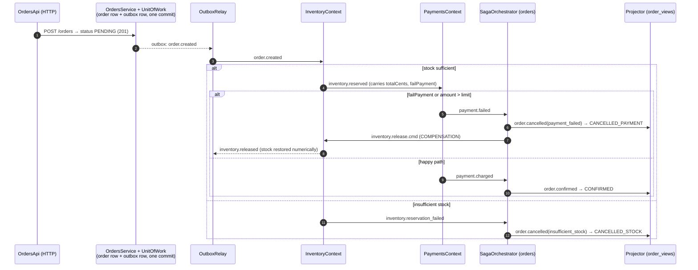

# Capstone 4 — Solution: E-commerce Microservices (single deployable, three bounded contexts)

Reference answer key for the synthesis capstone. One NestJS process hosts **orders**, **inventory**, and **payments** as strictly separated bounded contexts that cooperate only through an in-memory event bus — the full saga / outbox / inbox / CQRS toolkit with **zero external services**.

## What this is

- A complete checkout saga: place order → reserve stock → charge payment → confirm, with compensations on every failure path.
- The reliability primitives from the curriculum, production-shaped but dependency-free: transactional outbox + relay, consumer-side inbox dedupe, retry with dead letters, integer-cent money.
- A teaching artifact: every adapter is swappable. `db/migrations/0001_init.sql` documents the durable (Postgres) equivalent of each in-memory store; the SQL is a blueprint, not something the runtime connects to.

## Why single-deployable (and the split path)

One deployable keeps the suite green offline and makes the *boundaries* the unit of study instead of the plumbing. Folder discipline is enforced by `test/architecture.spec.ts`: contexts import only `src/lib` (infrastructure ports) and `src/contracts` (the event schema) — never each other.

Splitting into real services later:

1. Extract each context folder into its own repo/deployable (they already have module roots and no cross-imports).
2. Swap `MemEventBus`/`MemOutboxStore` adapters for Redis Streams or Kafka behind the same `EventBusPort`/`OutboxStorePort` interfaces.
3. Give each service its own Postgres running `0001_init.sql` (plus mirrored outbox/inbox tables).
4. Replace `POST /__admin/drain` with the relay interval already present (`AUTO_RELAY_MS`).

The ports exist precisely so nothing else has to change.

## Quickstart

```bash
pnpm install
pnpm test          # full offline suite
pnpm build && pnpm start   # PORT=3004
```

Or: `docker compose up --build`, then the same curl tour against `localhost:3004`.

### API tour

```bash
# 1. Place an order - returns PENDING immediately; progression is async via the bus.
curl -sS -X POST localhost:3004/orders \
  -H 'content-type: application/json' \
  -d '{"userId":"u1","items":[{"sku":"SKU-1","qty":2},{"sku":"SKU-2","qty":1}]}'

# 2. Write model: poll until CONFIRMED (saga runs on the relay interval).
curl -sS localhost:3004/orders/<orderId>

# 3. Read model: denormalized view kept fresh by the projector.
curl -sS localhost:3004/orders/view/<orderId>

# 4. Stock levels + current holds (see it decrement after step 2).
curl -sS localhost:3004/inventory

# 5. Failure drill: chaos flag declines the payment -> watch stock come BACK.
curl -sS -X POST localhost:3004/orders \
  -H 'content-type: application/json' \
  -d '{"userId":"u1","items":[{"sku":"SKU-1","qty":3}],"failPayment":true}'

# 6. Explicit pump (what the tests use): drain outbox + settle all handlers now.
curl -sS -X POST localhost:3004/__admin/drain

# 7. Liveness/readiness.
curl -sS localhost:3004/healthz localhost:3004/readyz
```

## Milestone map

| Build-guide milestone | Where it lives | Proven by |
|---|---|---|
| M1 scaffolding & contracts | `package.json`, `tsconfig*.json`, `Dockerfile`, `src/contracts/events.ts` (the versioned-schema package), `test/architecture.spec.ts` | architecture fence test |
| M3 orders + transactional outbox | `src/orders/unit-of-work.ts`, `src/lib/outbox.ts`, `src/lib/relay.ts`, `src/lib/inbox.ts` | `src/lib/outbox-relay.spec.ts`, `src/lib/inbox.spec.ts`, `test/idempotency.spec.ts` |
| M4 payments & inventory + saga | `src/inventory/`, `src/payments/`, `src/orders/saga-orchestrator.ts` | `test/saga-happy.spec.ts`, `test/saga-insufficient-stock.spec.ts`, `test/saga-payment-compensation.spec.ts`, `test/saga-payment-limit.spec.ts` |
| M5 notifications/observability stand-in | `src/orders/cqrs/` (read model consumers), pino logger, request-id middleware | `test/projector.spec.ts`, `test/http-contract.spec.ts` |
| M6 chaos & proof | `failPayment` chaos hook, duplicate-delivery injection, `__admin/drain` seam | `test/idempotency.spec.ts`, `test/saga-payment-compensation.spec.ts` |

Gateway/catalog/notifications services are intentionally out of scope for this answer key; their patterns are represented by the contracts package, the projector, and the health/admin endpoints respectively.

## Architecture



Every hop passes through the outbox/inbox/retry primitives: at-least-once delivery, deduped consumption, compensated failures. Payments additionally treats `orderId` as its idempotency key, so even a *different* eventId replaying the same intent cannot double-charge.

## Decisions

| Decision | Rationale |
|---|---|
| Single deployable, three contexts | Keeps the answer key offline-green; boundaries (not plumbing) are the lesson. Architecture spec test enforces imports. |
| In-memory EventBus as port | Same two verbs as Kafka/Redis Streams; swap adapters when splitting, zero code changes elsewhere. |
| Outbox on orders only | The atomic-write lesson lives where state+event must commit together (order row). Inventory/payments publish directly here; the split gives each its own outbox+relay (SQL blueprint included). |
| Relay tick loops until drained | Multi-hop sagas converge in one `tick()` because handler chains append rows synchronously; bounded by maxPasses to surface runaway loops. |
| Inbox claim-before-process | Mirrors `INSERT ... ON CONFLICT DO NOTHING` in the same tx as side effects; replays skip, never double-spend. |
| Payments idempotency beyond inbox | Different-eventId redelivery of the same orderId is realistic (relay retries, upstream bugs); the attempted-set is the payments idempotency-key story. |
| Projector consumes only `order.*` facts | Read model survives a split untouched; cancellations arrive normalized as `order.cancelled{reason}` rather than raw foreign outcomes. |
| Integer cents everywhere | `money.sumItems` rejects floats and unknown skus; totals are exact by construction. |
| `/__admin/drain` endpoint | Explicit test/demo seam; production relies on the background relay interval (`AUTO_RELAY_MS`). |
| Chaos via `failPayment` flag | Deterministic decline drills without killing processes; rides the event chain exactly like a real decline would. |

## Configuration

See `.env.example`. Defaults: `PORT=3004`, `PAYMENT_LIMIT_CENTS=50000`, seeded stock/prices overridable via JSON env vars. SIGTERM/SIGINT shut down gracefully (relay timer cleared, HTTP server closed).

## Scope note vs the brief

The brief's six-service platform collapses to three contexts plus shared infrastructure here; gateway, catalog, and notifications are represented by their teaching artifacts (contracts package, price map, projector). The README section above is the documented path back to six deployables.

## Resume bullet

*"Checkout-saga commerce backend (NestJS): choreographed orders/inventory/payments contexts communicating purely over events — transactional outbox→relay publishing, inbox-dedupe + payment idempotency keys for effectively-once effects, compensating releases on declines, CQRS read models — chaos-tested (duplicate deliveries, forced declines) in a fully offline suite."*
